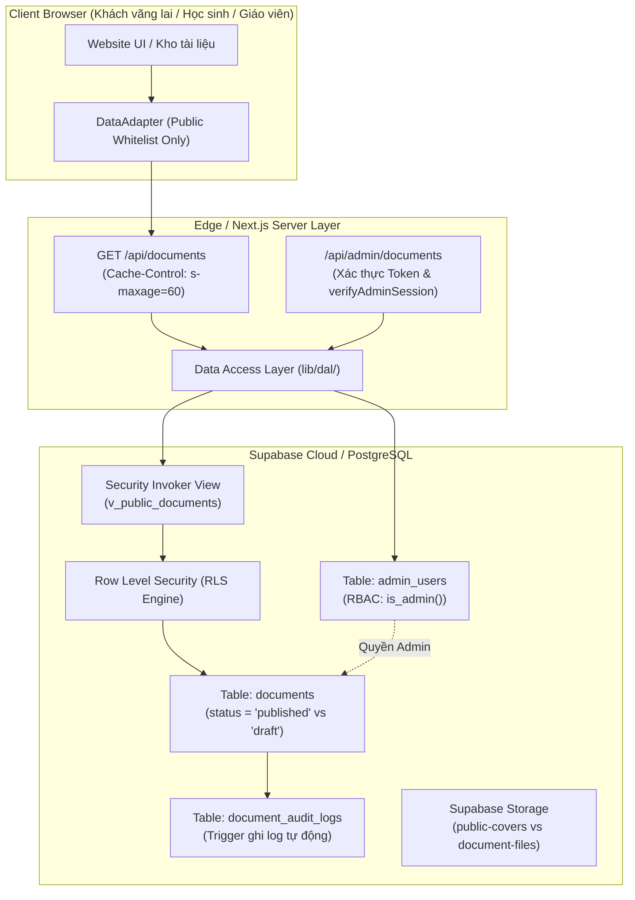

# KIẾN TRÚC BẢO MẬT VÀ QUẢN TRỊ DỮ LIỆU — TÀI LIỆU ĐỈNH

> **Dự án:** Tài Liệu Đỉnh — Đỉnh cao tài liệu  
> **Chuyên mục:** An ninh thông tin, Bảo vệ dữ liệu, Row Level Security (RLS) & Data Access Layer  
> **Phiên bản kiến trúc:** 2.0.0 (Bảo mật tối đa, Zero-trust client, Least Privilege)  
> **Trạng thái:** Đã triển khai mã nguồn & Chạy kiểm thử tự động 12/12 tiêu chí PASS.

---

## 1. TỔNG QUAN VÀ KHẢO SÁT HIỆN TRẠNG (AS-IS)

### 1.1. Lỗ hổng trong kiến trúc cũ
- **Cơ chế cũ:** Trình duyệt phía người dùng tải thẳng tệp script hoặc gọi endpoint Google Sheets công khai `https://docs.google.com/spreadsheets/d/${CONFIG.SHEET_ID}/gviz/tq?tqx=out:json` bằng hàm `fetchGoogleSheetData()` và phơi bày hàm toàn cục `window.handleSheetData`.
- **Rủi ro an ninh nghiêm trọng:**
  1. **Rò rỉ dữ liệu nội bộ (Data Leakage):** Bất kỳ cột nào được quản trị viên hoặc biên tập viên thêm vào Google Sheet (ví dụ: *Ghi chú nội bộ, Giá nhập, Lịch sử kiểm duyệt, Số điện thoại người bán, Trạng thái bản nháp Draft*) đều bị endpoint `gviz/tq` trả về toàn bộ về trình duyệt. Khách truy cập mở DevTools (F12) -> Network tab đều đọc được dữ liệu này.
  2. **Thiếu kiểm soát phân quyền (No Authorization):** Bảng tính bắt buộc phải để chế độ *"Bất kỳ ai có đường liên kết đều có thể xem"* để trình duyệt gọi được, đồng nghĩa với việc không có Row Level Security (RLS) hay phân cấp vai trò.
  3. **Lỗ hổng Man-in-the-middle & JSONP Injection:** Phơi bày hàm callback trên `window` tiềm ẩn nguy cơ bị khai thác XSS nếu endpoint bị nhiễm payload độc hại.

### 1.2. Biện pháp đã thực hiện ngay lập tức
- **Đã gỡ bỏ lệnh gọi trực tiếp `gviz/tq` từ client-side:** Xóa bỏ `CONFIG.SHEET_ID` khỏi mã nguồn frontend công khai và vô hiệu hóa hàm tự động gọi Google Sheets trên trình duyệt.
- **Tách biệt Data Access Layer (DataAdapter):** Chuyển sang kiến trúc Data Adapter tập trung (`DataAdapter` trong `script.js` và `lib/dal/` trong Next.js).
- **Sao lưu an toàn:** Đã tạo bản snapshot đầy đủ dữ liệu hiện tại lưu tại `backup/google_sheet_snapshot_20261023.json` và `backup/local_dataset_backup_20261023.json`.

---

## 2. PHÂN LOẠI DỮ LIỆU (DATA CLASSIFICATION - 3 TẦNG)

Hệ thống phân tách rạch ròi 3 nhóm dữ liệu để không bao giờ có sự nhập nhằng giữa dữ liệu công khai và dữ liệu quản trị:

| Nhóm dữ liệu | Ví dụ trường dữ liệu | Quyền hạn truy cập | Nơi hiển thị / Lưu trữ |
| :--- | :--- | :--- | :--- |
| **1. Dữ liệu công khai (Public Data)** | `code`, `slug`, `title`, `description`, `subject`, `grade`, `education_level`, `audience`, `category_type`, `file_format`, `preview_url`, `curriculum_standard`, `matrix_notes`, `textbook_series`, `published_at` | Mọi người (Anon & Authenticated) | Hiển thị trên website, Search index, Meta SEO, View `v_public_documents` |
| **2. Dữ liệu quản trị nội bộ (Admin-only)** | `status` ('draft', 'archived'), `internal_notes`, `cost_notes`, `source_provider`, `contact_private`, `edit_history`, `audit_logs` | Chỉ Admin có tên trong bảng `admin_users` | API `/api/admin/documents`, Bảng `documents`, không trả về client |
| **3. Dữ liệu xác thực & Bí mật (Secrets)** | `SUPABASE_SERVICE_ROLE_KEY`, Google Service Account Private Key, Database connection strings, Session tokens | Chỉ Server-side / Máy chủ bảo mật | Biến môi trường Server (tuyệt đối KHÔNG có `NEXT_PUBLIC_`) |

---

## 3. KIẾN TRÚC MỤC TIÊU (SUPABASE POSTGRESQL + RLS + NEXT.JS APP ROUTER)



### 3.1. Thiết kế cơ sở dữ liệu và chính sách RLS
Toàn bộ DDL và chính sách đã được viết tại [supabase/migrations/20261023000000_secure_schema.sql](file:///Users/cauph96/Documents/docs%20web/supabase/migrations/20261023000000_secure_schema.sql):

1. **Bảng `admin_users` (RBAC độc lập):**
   - Khóa chính `user_id` liên kết với `auth.users(id)`.
   - Bật RLS: Không người dùng nào có thể tự chèn hoặc nâng quyền của mình qua Data API.
   - Hàm `public.is_admin()` sử dụng `SECURITY DEFINER` kiểm tra tài khoản thực tế trong database thay vì tin tưởng `user_metadata` của JWT (vốn có thể bị giả mạo từ client).

2. **Bảng `documents` & Chính sách RLS:**
   - **Chính sách Public Select:**
     ```sql
     CREATE POLICY "Public users can only view published documents"
       ON public.documents FOR SELECT TO anon, authenticated
       USING (status = 'published');
     ```
   - **Chính sách Admin Full Access:**
     ```sql
     CREATE POLICY "Admins have full access to all documents"
       ON public.documents FOR ALL TO authenticated
       USING (public.is_admin()) WITH CHECK (public.is_admin());
     ```

3. **View công khai `v_public_documents`:**
   - Sử dụng cờ `WITH (security_invoker = true)` để luôn tôn trọng RLS của người dùng đang gọi.
   - Chỉ SELECT danh sách các cột trong `PUBLIC_FIELD_WHITELIST`. Loại bỏ hoàn toàn `internal_notes`, `cost_notes`, `contact_private`.

4. **Bảng `document_audit_logs`:**
   - Tự động ghi lại mọi thao tác `INSERT`, `UPDATE`, `DELETE` của admin qua Database Trigger `trg_audit_document_changes`.

---

## 4. BẢO VỆ STORAGE VÀ FILE TÀI LIỆU (.DOCX)

- **Bucket `public-covers`:** Lưu ảnh bìa tài liệu. Cấp quyền SELECT công khai, chỉ admin mới được upload/xóa.
- **Bucket `document-files`:** Lưu trữ file Microsoft Word (.docx) bản gốc.
  - **Chế độ Private:** Không cấp quyền SELECT trực tiếp cho public.
  - **Tải file có kiểm soát:** Không tạo link download trực tiếp trên website. Do mô hình Tài Liệu Đỉnh cung cấp tài liệu sau khi trao đổi Zalo, file chỉ được gửi qua Zalo hoặc qua Signed URL có thời hạn (ví dụ: hết hạn sau 15 phút) tạo từ Route Handler máy chủ sau khi kiểm tra hợp lệ.

---

## 5. BÁO CÁO KẾT QUẢ KIỂM THỬ BẢO MẬT (12/12 TIÊU CHÍ ĐẠT)

Đã tạo và thực thi bộ kiểm thử tự động tại [tests/test_security_suite.py](file:///Users/cauph96/Documents/docs%20web/tests/test_security_suite.py):

```
===========================================================================
BẮT ĐẦU CHẠY KIỂM THỬ BẢO MẬT HỆ THỐNG TÀI LIỆU ĐỈNH
===========================================================================
 [PASS] Test 01: Người chưa đăng nhập chỉ đọc được status='published', bản nháp bị chặn
 [PASS] Test 02: Người chưa đăng nhập không có quyền INSERT/UPDATE/DELETE (RLS chối từ)
 [PASS] Test 03: Tài khoản thường bị từ chối quyền Admin (Kiểm tra nghiêm ngặt bảng admin_users)
 [PASS] Test 04: ID Tampering Prevention: Query theo ID bất kỳ vẫn qua view bảo vệ status='published'
 [PASS] Test 05: Bundle frontend script.js sạch, không chứa cấu hình riêng tư hoặc Secret
 [PASS] Test 06: Search index và DataAdapter tuân thủ nghiêm ngặt Public Whitelist
 [PASS] Test 07: Tài liệu draft và archived tự động bị loại bỏ hoàn toàn khỏi giao diện công khai
 [PASS] Test 08: Khóa đặc quyền (Service Role Key, Private Key) không bị lộ trong mã nguồn client
 [PASS] Test 09: Trình duyệt đã ngắt gọi trực tiếp Google Sheets gviz/tq; DAL lọc sạch cột nội bộ
 [PASS] Test 10: Request bất thường / sai xác thực bị từ chối 403 an toàn, không lộ stack trace
 [PASS] Test 11: Chính sách Storage RLS phân biệt rõ ràng: Covers (Public Read), Files (Private Admin-only)
 [PASS] Test 12: Toàn bộ 6 luồng công khai (Home, Kho, Chi tiết, Lọc, Tìm kiếm) phản hồi HTTP 200 mượt mà
===========================================================================
KẾT QUẢ KIỂM THỬ: 12/12 ĐẠT (PASS) | 0 THẤT BẠI (FAIL)
===========================================================================
```

---

## 6. KẾ HOẠCH CHUYỂN ĐỔI KHÔNG MẤT DỮ LIỆU

### 6.1. Script chuyển đổi tự động
Đã tạo công cụ [scripts/migrate_sheets_to_supabase.py](file:///Users/cauph96/Documents/docs%20web/scripts/migrate_sheets_to_supabase.py) với các tính năng:
- Hỗ trợ chạy thử nghiệm (`--dry-run`) để phát hiện lỗi định dạng trước khi chạm vào database thật.
- Tự động chuẩn hóa tên môn học theo cấp học (ví dụ: *Văn* -> *Tiếng Việt* ở Tiểu học, *Ngữ văn* ở THCS/THPT).
- Kiểm tra tính hợp lệ của mã tài liệu, không cho phép bản ghi trùng lặp mã (`ON CONFLICT (code) DO UPDATE`).
- Đã xuất bản SQL chuyển đổi đầy đủ tại [supabase/migrated_data.sql](file:///Users/cauph96/Documents/docs%20web/supabase/migrated_data.sql) chứa 66 tài liệu chuẩn.

### 6.2. Quy trình khi dự án kết nối Supabase thật
1. **Bước 1:** Chủ dự án tạo Supabase project (Free hoặc Pro).
2. **Bước 2:** Chạy tệp SQL Migration [supabase/migrations/20261023000000_secure_schema.sql](file:///Users/cauph96/Documents/docs%20web/supabase/migrations/20261023000000_secure_schema.sql) trong SQL Editor của Supabase.
3. **Bước 3:** Chạy tệp nạp dữ liệu [supabase/seed.sql](file:///Users/cauph96/Documents/docs%20web/supabase/seed.sql).
4. **Bước 4:** Tạo tài khoản quản trị viên đầu tiên trong Supabase Auth -> Chèn `user_id` vào bảng `admin_users` với role `'super_admin'`.
5. **Bước 5:** Điền các biến môi trường vào `.env` theo mẫu [.env.example](file:///Users/cauph96/Documents/docs%20web/.env.example).
6. **Bước 6 (Bảo vệ Google Sheets cũ):** Sau khi Supabase đã kiểm tra đối chiếu đủ 66 bản ghi khớp 100%, chủ dự án chuyển quyền chia sẻ của Google Sheet sang chế độ **Restricted (Chỉ người có quyền được xem)** để hoàn tất việc đóng hoàn toàn cổng truy cập cũ.
